<picture>
  <source media="(prefers-color-scheme: dark)" srcset="assets/header-dark.svg">
  
</picture>

I'm Harsha. I spent more than a decade across hardware operations, data centers and AI, and now I build small, fast tools for the Mac, Android and AI coding agents. I care how systems work, and I care even more about making them useful for real people.

I'm open-sourcing a lot of what I've built. Here's what's out so far.

### 🖥️ Mac apps

<table>
  <tr>
    <td width="50%" valign="top">
      <a href="https://github.com/hkay-dev/finch"><b>Finch</b></a> Rust · GPUI 
      A small, fast text editor for the Mac, with a Markdown preview.
    </td>
    <td width="50%" valign="top">
      <a href="https://github.com/hkay-dev/zag"><b>Zag</b></a> Zig 
      A small native macOS text editor written from scratch in Zig. <a href="https://zag.hkay.me">zag.hkay.me</a>
    </td>
  </tr>
  <tr>
    <td width="50%" valign="top">
      <a href="https://github.com/hkay-dev/fanbar"><b>Fanbar</b></a> menu bar 
      Tiny fan control for Apple Silicon Macs, with live CPU power, clocks and temps.
    </td>
    <td width="50%" valign="top">
      <a href="https://github.com/hkay-dev/closeup"><b>Closeup</b></a> Swift 
      Your Android phone, as your Mac's webcam. A menu bar app over USB or Wi-Fi.
    </td>
  </tr>
</table>

### 🤖 Agent tools

<table>
  <tr>
    <td width="50%" valign="top">
      <a href="https://github.com/hkay-dev/OhMyStash"><b>OhMyStash</b></a> Oh My Pi plugin 
      Stash unfinished prompts, images and pastes, then browse, search and restore them across chats.
    </td>
    <td width="50%" valign="top">
      <a href="https://github.com/hkay-dev/omp-utility-skills"><b>omp-utility-skills</b></a> Oh My Pi skills 
      Portable skills that teach an agent the Oh My Pi docs and config.
    </td>
  </tr>
  <tr>
    <td width="50%" valign="top">
      <a href="https://github.com/hkay-dev/opencode-limits-sidebar"><b>opencode-limits-sidebar</b></a> OpenCode plugin 
      Your OpenUsage quotas, limits and resets in the OpenCode sidebar.
    </td>
    <td width="50%" valign="top">
      <a href="https://github.com/hkay-dev/cc-fi"><b>cc-fi</b></a> Python 
      Fast fuzzy search for Claude Code sessions across your filesystem.
    </td>
  </tr>
</table>

### 📱 Android and odds and ends

- **[chirp-android](https://github.com/hkay-dev/chirp-android)**: on-device Parakeet speech-to-text, built into a voice notes app and a dictation keyboard.
- **[reddit-scraper](https://github.com/hkay-dev/reddit-scraper)**: pulls a whole Reddit thread, every comment in its place, in a few seconds.
- **[cruise-control-progression-customizer](https://github.com/hkay-dev/cruise-control-progression-customizer)**: tune the money and XP multipliers in Motor Town: Behind The Wheel.

### 🧰 What I build with

### 🌐 Elsewhere

Away from the screen, I'm tinkering with mechanical keyboards, chasing the most efficient factory in Satisfactory, and keeping my recklessly brave puppy, Pixel, from inventing new ways to get himself killed.
